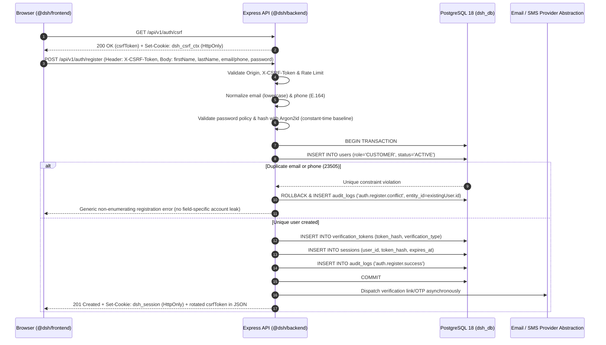
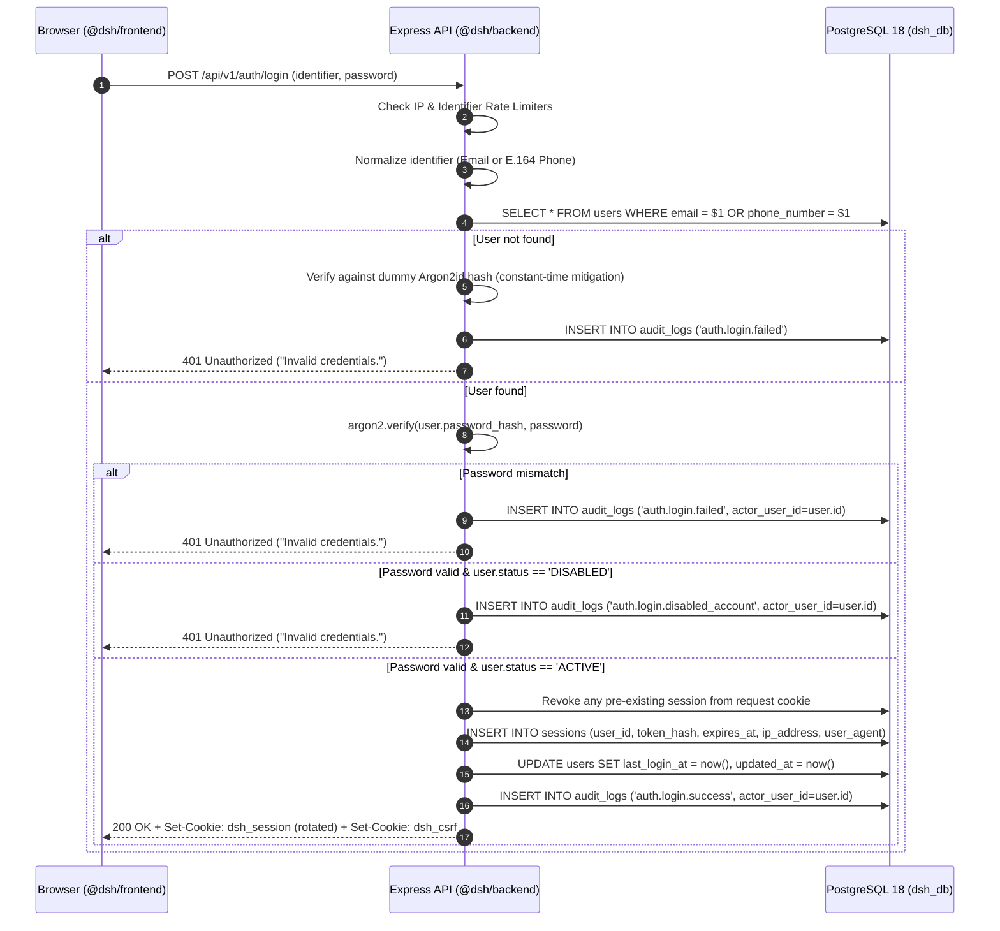
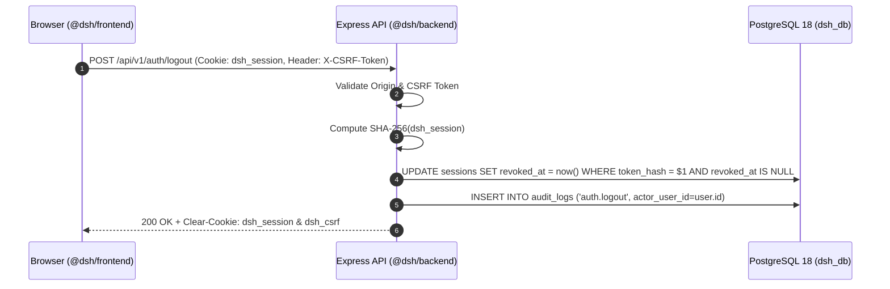
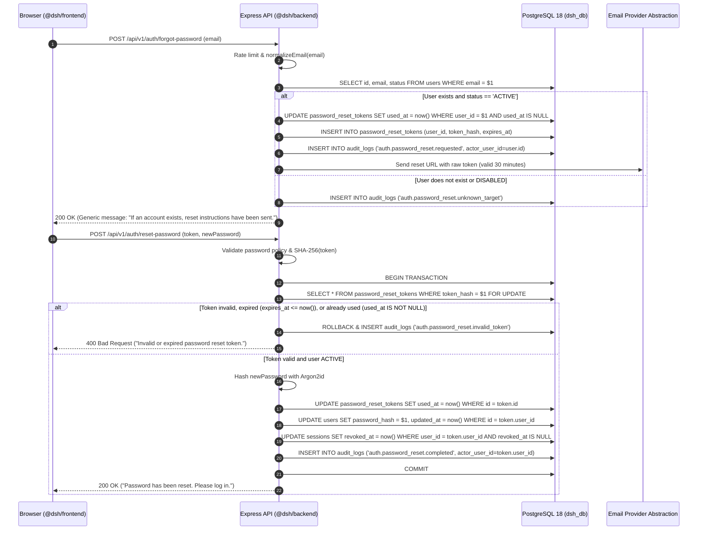

# Digital Services Hub (DSH) — Authentication & Security Architecture

## 1. Architectural Principles & Trust Boundaries

1. **Backend-Only Authentication Authority**:
   - All authentication, password hashing, token generation, session lookup, and role-based access control (RBAC) live exclusively in `@dsh/backend` (`backend/`).
   - `@dsh/frontend` (`frontend/`) communicates with `@dsh/backend` exclusively over HTTP REST APIs (`/api/v1/auth/*` and protected resource routes) and never connects to PostgreSQL or imports Drizzle ORM schemas.
   - Single PostgreSQL connection pool: Authentication services reuse the existing singleton `db` and `pool` in [`backend/src/db/client.ts`](file:///home/codewithfred/Projects/DHS/backend/src/db/client.ts).
2. **Server-Side Stateful Sessions**:
   - DSH uses opaque, cryptographically random session tokens backed by the PostgreSQL [`sessions`](file:///home/codewithfred/Projects/DHS/backend/src/db/schema/sessions.ts#L15-L39) table rather than stateless JWTs, enabling immediate server-side revocation on logout, password change, password reset, role change, or account deactivation.
3. **Zero Plaintext Secrets in Storage or Logs**:
   - Passwords are stored exclusively as **Argon2id** hashes in [`users.password_hash`](file:///home/codewithfred/Projects/DHS/backend/src/db/schema/users.ts#L22).
   - Session tokens, password reset tokens, and verification tokens are hashed with **SHA-256** (`token_hash`) before storage in [`sessions`](file:///home/codewithfred/Projects/DHS/backend/src/db/schema/sessions.ts#L22), [`password_reset_tokens`](file:///home/codewithfred/Projects/DHS/backend/src/db/schema/sessions.ts#L48), and [`verification_tokens`](file:///home/codewithfred/Projects/DHS/backend/src/db/schema/sessions.ts#L72).
   - Raw passwords, password hashes, raw session tokens, reset tokens, and verification codes must never be written to `console`, application logs, or [`audit_logs.metadata`](file:///home/codewithfred/Projects/DHS/backend/src/db/schema/audit.ts#L31-L34).

---

## 2. Existing Authentication Schema Audit

Inspected [`backend/src/db/schema/users.ts`](file:///home/codewithfred/Projects/DHS/backend/src/db/schema/users.ts), [`backend/src/db/schema/sessions.ts`](file:///home/codewithfred/Projects/DHS/backend/src/db/schema/sessions.ts), [`backend/src/db/schema/audit.ts`](file:///home/codewithfred/Projects/DHS/backend/src/db/schema/audit.ts), and [`backend/src/db/schema/enums.ts`](file:///home/codewithfred/Projects/DHS/backend/src/db/schema/enums.ts):

### 2.1 `users` Table
- `id`: `uuid` PK (`defaultRandom()`)
- `first_name`: `varchar(100)` NOT NULL
- `last_name`: `varchar(100)` NOT NULL
- `email`: `varchar(255)` nullable, unique (`users_email_unique`)
- `phone_number`: `varchar(32)` nullable, unique (`users_phone_number_unique`)
- `password_hash`: `text` NOT NULL
- `role`: `user_role` enum (`CUSTOMER`, `STAFF`, `ADMIN`, `SUPER_ADMIN`), NOT NULL, default `'CUSTOMER'`
- `status`: `account_status` enum (`ACTIVE`, `DISABLED`), NOT NULL, default `'ACTIVE'`
- `email_verified_at`: `timestamptz` nullable
- `phone_verified_at`: `timestamptz` nullable
- `last_login_at`: `timestamptz` nullable
- `created_at` / `updated_at`: `timestamptz` NOT NULL
- **Database Constraints**:
  - `users_contact_required_chk`: `email IS NOT NULL OR phone_number IS NOT NULL`
  - `users_email_normalized_chk`: `email IS NULL OR (email = lower(trim(email)) AND char_length(email) >= 3)`
  - `users_phone_normalized_chk`: `phone_number IS NULL OR (phone_number = trim(phone_number) AND phone_number ~ '^\+[1-9][0-9]{7,14}$')`

### 2.2 `sessions` Table
- `id`: `uuid` PK
- `user_id`: `uuid` NOT NULL FK -> `users.id` (`ON DELETE CASCADE`)
- `token_hash`: `varchar(128)` NOT NULL, unique (`sessions_token_hash_unique`)
- `expires_at`: `timestamptz` NOT NULL
- `revoked_at`: `timestamptz` nullable
- `ip_address`: `varchar(64)` nullable
- `user_agent`: `text` nullable
- `created_at`: `timestamptz` NOT NULL
- **Database Constraints**:
  - `sessions_expires_after_created_chk`: `expires_at > created_at`
  - Index `sessions_user_id_expires_idx` on `(user_id, expires_at)`

### 2.3 `password_reset_tokens` Table
- `id`: `uuid` PK
- `user_id`: `uuid` NOT NULL FK -> `users.id` (`ON DELETE CASCADE`)
- `token_hash`: `varchar(128)` NOT NULL, unique (`password_reset_tokens_hash_unique`)
- `expires_at`: `timestamptz` NOT NULL
- `used_at`: `timestamptz` nullable
- `created_at`: `timestamptz` NOT NULL
- **Database Constraints**:
  - `password_reset_tokens_expires_chk`: `expires_at > created_at`

### 2.4 `verification_tokens` Table
- `id`: `uuid` PK
- `user_id`: `uuid` NOT NULL FK -> `users.id` (`ON DELETE CASCADE`)
- `token_hash`: `varchar(128)` NOT NULL, unique (`verification_tokens_hash_unique`)
- `verification_type`: `verification_type` enum (`EMAIL`, `PHONE`), NOT NULL
- `expires_at`: `timestamptz` NOT NULL
- `used_at`: `timestamptz` nullable
- `created_at`: `timestamptz` NOT NULL
- **Database Constraints**:
  - `verification_tokens_expires_chk`: `expires_at > created_at`

### 2.5 `audit_logs` Table
- `id`: `uuid` PK
- `actor_user_id`: `uuid` nullable FK -> `users.id` (`ON DELETE SET NULL`)
- `action`: `varchar(120)` NOT NULL
- `entity_type`: `varchar(80)` NOT NULL
- `entity_id`: `varchar(128)` nullable
- `metadata`: `jsonb` NOT NULL default `{}`
- `ip_address`: `varchar(64)` nullable
- `created_at`: `timestamptz` NOT NULL
- Protected by PostgreSQL trigger `audit_logs_prevent_mutation_trg` (`prevent_append_only_mutation()`).

---

## 3. Authentication Lifecycles & Sequence Diagrams

### 3.1 Registration Lifecycle (`POST /api/v1/auth/register`)

1. **Public Role Enforcement**:
   - Public registration strictly sets `role = 'CUSTOMER'` and `status = 'ACTIVE'`. Any `role` or `status` field sent in the request payload is rejected or stripped by input validation.
2. **Contact Validation & Normalization**:
   - At least one of `email` or `phoneNumber` is required (matching `users_contact_required_chk`).
   - If `email` is provided, normalize via [`normalizeEmail()`](file:///home/codewithfred/Projects/DHS/backend/src/db/normalize.ts#L12-L18) (`trim().toLowerCase()`).
   - If `phoneNumber` is provided, normalize via [`normalizePhoneNumber()`](file:///home/codewithfred/Projects/DHS/backend/src/db/normalize.ts#L28-L44) to E.164 (`+2547XXXXXXXX` / `+2541XXXXXXXX`).
3. **Duplicate Account & Anti-Enumeration Handling**:
   - Validate password policy and compute the **Argon2id** hash *before* branching on duplicate checks so response timing remains uniform whether the email/phone is new or already registered.
   - Check for existing users matching normalized `email` or `phone_number`, and handle PostgreSQL unique constraint violations (`23505` on `users_email_unique` or `users_phone_number_unique`).
   - **Anti-Enumeration Public Response**: Do not expose whether the email or phone number specifically belongs to an existing account or reveal any existing account profile details. Return a generic `400 Bad Request` / `409 Conflict` response (`"Unable to complete registration with the provided details. If you already have an account, please sign in or use password recovery."`) with uniform error structure across email and phone collisions.
   - **Internal Audit Trail**: Record the exact collision context internally in `audit_logs` (`action = 'auth.register.conflict'`, `entity_type = 'user'`, `entity_id = existingUser.id`, with non-sensitive metadata indicating `conflictField: 'email' | 'phoneNumber'`) so administrators have full visibility without leaking account existence through HTTP responses.
4. **Password Validation & Hashing**:
   - Validate password policy (8–128 characters, not blank, contains at least one letter and one number/symbol).
   - Hash with **Argon2id** before entering the database transaction.
5. **User, Verification Token & Initial Session Creation (Consistent Token Rotation)**:
   - **On Successful Registration (`201 Created`)**: Inside a database transaction:
     - Insert row into `users` (`role = 'CUSTOMER'`, `status = 'ACTIVE'`, `email_verified_at = NULL`, `phone_verified_at = NULL`).
     - Generate verification token(s) for each supplied contact channel (`EMAIL` and/or `PHONE`), store SHA-256 `token_hash` in `verification_tokens`, and queue out-of-band delivery.
     - Create an initial server-side session in `sessions`, set the `dsh_session` `HttpOnly` cookie, clear the pre-authentication `dsh_csrf_ctx` cookie (`Max-Age=0`), and rotate the CSRF token to a session-bound token (`"sess:" + session.tokenHash + ...`) returned in the JSON body (`data.csrfToken`).
     - Record `auth.register.success` in `audit_logs`.
   - **On Rejected / Duplicate Registration (`400 REGISTRATION_REJECTED`)**:
     - Because no authenticated session is created when registration is rejected, `dsh_session` is **not** set, `dsh_csrf_ctx` is **not** cleared, and no session-bound CSRF rotation occurs. The caller remains in the pre-authentication CSRF context, preventing side-channel detection of duplicate accounts through cookie or token rotation differences.



---

### 3.2 Login Lifecycle (`POST /api/v1/auth/login`)

1. **Identifier Resolution**:
   - Accepts `identifier` (email or phone number) and `password`.
   - If `identifier` contains `@`, normalize via `normalizeEmail(identifier)` and query `users.email`.
   - Otherwise, normalize via `normalizePhoneNumber(identifier)` and query `users.phone_number`.
2. **Timing-Safe Verification & Enumeration Prevention**:
   - Rate limit by IP address and normalized identifier before database lookup.
   - If no user matches `identifier`, verify the supplied password against a precomputed dummy Argon2id hash so response timing matches an existing account, log `auth.login.failed`, and return `401 Unauthorized` (`"Invalid credentials."`).
   - If the user exists, verify `password` against `users.password_hash` using Argon2id.
   - If password verification fails, log `auth.login.failed` (with `actor_user_id = user.id`) and return `401 Unauthorized` (`"Invalid credentials."`).
3. **Account Status Enforcement**:
   - The PostgreSQL `account_status` enum supports `ACTIVE` and `DISABLED`.
   - Every non-`ACTIVE` user (`user.status !== 'ACTIVE'`, i.e. `'DISABLED'`) is denied authentication: no session is created, `auth.login.disabled_account` is recorded in `audit_logs`, and a generic `401 Unauthorized` (`INVALID_CREDENTIALS`: `"Invalid credentials."`) is returned so login responses never disclose whether an account is disabled or whether the password was wrong.
4. **Session Rotation & Issuance**:
   - If the request already carries an existing `dsh_session` cookie, revoke that previous session row (`revoked_at = now()`) to prevent session fixation.
   - Generate a new 32-byte (256-bit) CSPRNG session token, hash it with SHA-256 (`token_hash`), and insert a new row into `sessions`.
   - Update `users.last_login_at = now()` and `users.updated_at = now()`.
   - Record `auth.login.success` in `audit_logs`.
   - Set new `dsh_session` (`HttpOnly`) and rotated `dsh_csrf` cookies.



---

### 3.3 Session Verification, Logout & Global Revocation

1. **Per-Request Session Verification Middleware (`requireAuth`)**:
   - Reads raw token from `req.cookies.dsh_session`.
   - Computes `tokenHash = sha256Hex(rawToken)`.
   - Queries `sessions` joined with `users` where:
     - `sessions.token_hash = tokenHash`
     - `sessions.revoked_at IS NULL`
     - `sessions.expires_at > now()`
     - `users.status = 'ACTIVE'`
   - If no row matches, clears the `dsh_session` cookie and returns `401 Unauthorized`; if the user's status is `DISABLED` (`status !== 'ACTIVE'`), clears the `dsh_session` cookie and returns `403 Forbidden` (`ACCOUNT_DISABLED`).
   - Attaches authenticated context `req.auth = { user, sessionId }` to the Express request.
2. **Single-Session Logout (`POST /api/v1/auth/logout`)**:
   - Marks the current session row `revoked_at = now()` in `sessions`.
   - Inserts `auth.logout` into `audit_logs`.
   - Clears `dsh_session` and `dsh_csrf` cookies (`Max-Age=0`).
3. **Logout All Devices (`POST /api/v1/auth/logout-all`)**:
   - Updates all active sessions for `req.auth.user.id`:
     `UPDATE sessions SET revoked_at = now() WHERE user_id = $1 AND revoked_at IS NULL`.
   - Inserts `auth.logout_all` into `audit_logs`.
   - Clears `dsh_session` and `dsh_csrf` cookies.



---

### 3.4 Password Recovery & Change Lifecycle



---

## 4. Password Security Specification

### 4.1 Library & Algorithm
- **Library**: `argon2` (Node.js native bindings to the reference C implementation) in `@dsh/backend`.
- **Variant**: **Argon2id** (`argon2.argon2id`), resistant to both GPU cracking and side-channel attacks.
- **Recommended Parameters (OWASP Minimums)**:
  - `type`: `argon2.argon2id`
  - `memoryCost`: `65536` (64 MiB)
  - `timeCost`: `3` iterations
  - `parallelism`: `4` lanes
  - `hashLength`: `32` bytes (with automatic 16-byte CSPRNG salt per hash encoded in PHC string format `$argon2id$v=19$m=65536,t=3,p=4$...`).

### 4.2 Password Policy & Input Validation
- **Length**: Minimum **8 characters**, maximum **128 characters** (prevents memory-exhaustion DoS on hashing).
- **Complexity**: Must contain at least one alphabetic character (`[a-zA-Z]`) and at least one numeric or symbol character (`[0-9!@#$%^&*()_+\-=\[\]{};':"\\|,.<>\/?]`), and must not consist solely of whitespace.
- **Preservation of Input**: Passwords are **not** trimmed before hashing (spaces inside passphrases are preserved), except rejecting passwords that are empty when trimmed.
- **Change Password (`POST /api/v1/auth/change-password`)**:
  - Requires active authenticated session.
  - Verifies `currentPassword` against `users.password_hash`.
  - Rejects `newPassword` if identical to `currentPassword`.
  - Updates `users.password_hash` with a fresh Argon2id hash.
  - **Session Rotation & Invalidation**: Revokes all existing sessions for the user (`revoked_at = now()`), issues a single fresh session token for the current device, and logs `auth.password.changed`.

---

## 5. Session Architecture

### 5.1 Token Generation & Hashing
- **Raw Token**: 32 cryptographically random bytes generated via `crypto.randomBytes(32).toString("base64url")` (256 bits of entropy, 43 URL-safe characters).
- **Stored Value**: `crypto.createHash("sha256").update(rawToken, "utf8").digest("hex")` (64 hex characters stored in `sessions.token_hash`).
- **Database Compromise Resilience**: Because SHA-256 is one-way and inputs have 256 bits of entropy, a read-only leak of the `sessions` table (e.g., via backup exposure) cannot be reversed into usable `dsh_session` cookies.

### 5.2 Session Lifetime & Rotation
| Role Tier | Default Session TTL | Rationale |
| :--- | :--- | :--- |
| `CUSTOMER` | **7 days** (`168 hours`) | Convenient portal access for repeat service orders and Wi-Fi management |
| `STAFF` | **12 hours** | Bounded to a single operational shift at the hub |
| `ADMIN` / `SUPER_ADMIN` | **8 hours** | Tighter window for high-privilege administrative sessions |

- **Session Rotation Triggers**:
  - On every login (`POST /api/v1/auth/login`), any existing session token presented by the browser is revoked and replaced with a new session row and new token.
  - On password change (`POST /api/v1/auth/change-password`), all prior sessions are revoked and a new session token is issued for the active device.
  - On role change or account deactivation by an administrator, all active sessions for the target user are immediately revoked (`UPDATE sessions SET revoked_at = now() WHERE user_id = $1 AND revoked_at IS NULL`).

---

## 6. Cookie, CORS & CSRF Security Design

### 6.1 Cookie Specification
| Cookie Name | Purpose | `HttpOnly` | `Secure` (Dev) | `Secure` (Prod) | `SameSite` | `Path` | `Max-Age` / TTL | `Domain` |
| :--- | :--- | :---: | :---: | :---: | :---: | :---: | :--- | :--- |
| `dsh_session` (`__Host-dsh_session` in prod HTTPS) | Raw opaque session token (authenticated users) | `true` | `false` (`localhost`) | `true` | `Lax` | `/` | Role-tiered (7d / 12h / 8h) | *(omitted — host-only)* |
| `dsh_csrf_ctx` (`__Host-dsh_csrf_ctx` in prod HTTPS) | Pre-authentication CSRF browser binding nonce | `true` | `false` (`localhost`) | `true` | `Lax` | `/` | **30 minutes** (`1800s`) | *(omitted — host-only)* |

- **Explicit `dsh_csrf_ctx` Cookie Flags**:
  - `HttpOnly`: `true` (inaccessible to `document.cookie`).
  - `SameSite`: `Lax`.
  - `Path`: `/`.
  - `Secure`: `true` in production (`NODE_ENV === "production"`), `false` on local HTTP (`localhost`) development.
  - `Domain`: **Omitted** (strictly host-only).
  - `Max-Age`: `1800` (30 minutes, aligned with the 30-minute CSRF token TTL).
- **Zero Web Storage Rule**: Neither session tokens nor CSRF tokens may ever be stored in `localStorage` or `sessionStorage`. Both cookies are strictly `HttpOnly`, and the CSRF token returned by `GET /api/v1/auth/csrf` is held exclusively in volatile JavaScript memory (React state / module memory) inside `@dsh/frontend`.

### 6.2 CORS Configuration
Configured in [`backend/src/app.ts`](file:///home/codewithfred/Projects/DHS/backend/src/app.ts#L11-L18):
- `origin`: Strictly bound to `env.frontendUrl` (`http://localhost:3000` in development, `https://...` in production). Wildcard `*` is strictly forbidden.
- `credentials`: `true`.
- `methods`: `["GET", "POST", "PUT", "PATCH", "DELETE", "OPTIONS"]`.
- `allowedHeaders`: `["Content-Type", "Authorization", "X-Requested-With", "X-CSRF-Token"]`.
- All frontend `fetch` requests to `@dsh/backend` must include `credentials: "include"`.

### 6.3 Full CSRF Token Lifecycle (`GET /api/v1/auth/csrf` & `X-CSRF-Token`)

Every state-changing browser request (`POST`, `PUT`, `PATCH`, `DELETE`) is protected by two mandatory layers: **strict `Origin` verification** and a **context-bound cryptographic CSRF token**.

#### 1. Token Structure, Explicit 30-Minute TTL & Cryptographic Binding
- **Explicit CSRF Token TTL**: **30 minutes** (`CSRF_TOKEN_TTL_MS = 30 * 60 * 1000 = 1,800,000 ms`).
- **Canonical 3-Part Format**:
  ```text
  <nonce>.<issuedAtUnixMs>.<hmacHex>
  ```
- `nonce`: 16 cryptographically random bytes (`crypto.randomBytes(16).toString("hex")`, 32 hex chars).
- `issuedAtUnixMs`: Base-10 Unix timestamp in milliseconds when the token was minted.
- `hmacHex`: 64-character lowercase hex digest computed with `HMAC-SHA256(SESSION_SECRET, payload)`, where `payload` depends on authentication state:
  - **Authenticated Context** (when a valid `dsh_session` cookie is present):
    ```text
    payload = "sess:" + session.tokenHash + ":" + nonce + ":" + issuedAtUnixMs
    ```
    This binds the CSRF token directly to the active PostgreSQL session's `token_hash`.
  - **Pre-Authentication Context** (before login/registration, when no valid `dsh_session` exists):
    - If `req.cookies.dsh_csrf_ctx` is not present, `GET /api/v1/auth/csrf` generates a 32-byte random context ID (`ctxId = crypto.randomBytes(32).toString("base64url")`) and sets it in the `dsh_csrf_ctx` `HttpOnly` cookie (`HttpOnly; SameSite=Lax; Path=/; Max-Age=1800`, plus `Secure` in production, no `Domain`).
    - `ctxHash = SHA256(ctxId)`.
    ```text
    payload = "anon:" + ctxHash + ":" + nonce + ":" + issuedAtUnixMs
    ```
    This binds pre-authentication requests (`/login`, `/register`, `/forgot-password`, `/reset-password`, `/verify-email`) to the caller's browser context cookie (`dsh_csrf_ctx`).

#### 2. How the Frontend Obtains & Stores the Token (`Cache-Control: no-store`)
- On application initialization (or prior to submitting a state-changing request if no valid token is in memory), `@dsh/frontend` calls `GET /api/v1/auth/csrf` with `credentials: "include"`.
- `GET /api/v1/auth/csrf` **must** set response header `Cache-Control: no-store` (along with `Pragma: no-cache`) so browsers, proxies, and CDNs never cache CSRF responses.
- The backend responds with `{ "status": "ok", "data": { "csrfToken": "<nonce>.<issuedAtUnixMs>.<hmacHex>", "expiresInSeconds": 1800 } }`.
- `@dsh/frontend` stores `csrfToken` strictly in **in-memory JavaScript state** (never in `localStorage`, `sessionStorage`, or `document.cookie`).

#### 3. How the Token is Submitted
- On every `POST`, `PUT`, `PATCH`, and `DELETE` request, `@dsh/frontend` attaches the in-memory token in the `X-CSRF-Token` HTTP header.

#### 4. How the Backend Validates the Token & Handles Expired Tokens
For every `POST`, `PUT`, `PATCH`, and `DELETE` request:
1. **Strict `Origin` Check**:
   - Read the `Origin` header (or extract the origin from `Referer` if `Origin` is absent).
   - Verify it exactly matches `env.frontendUrl`. If missing or mismatched, reject immediately with `403 Forbidden` (`CSRF_ORIGIN_MISMATCH`).
2. **Format Check**:
   - Read `X-CSRF-Token` header. Verify it splits into exactly 3 parts (`nonce`, `issuedAtUnixMs`, `providedHmacHex`), where `nonce` matches `/^[0-9a-f]{32}$/`, `issuedAtUnixMs` matches `/^[0-9]{13}$/`, and `providedHmacHex` matches `/^[0-9a-f]{64}$/`.
3. **Context Resolution & Timing-Safe HMAC Verification**:
   - If the request has an active authenticated session, compute `expectedHmacHex` using `"sess:" + session.tokenHash + ...`.
   - Otherwise, read `req.cookies.dsh_csrf_ctx` (rejecting with `403 CSRF_TOKEN_INVALID` if missing) and compute `expectedHmacHex` using `"anon:" + sha256(dsh_csrf_ctx) + ...`.
   - Convert both hex digests to `Buffer` objects and validate length before `crypto.timingSafeEqual()`:
     ```ts
     const providedBuf = Buffer.from(providedHmacHex, "hex");
     const expectedBuf = Buffer.from(expectedHmacHex, "hex");
     if (
       providedBuf.byteLength !== 32 ||
       providedBuf.byteLength !== expectedBuf.byteLength ||
       !crypto.timingSafeEqual(providedBuf, expectedBuf)
     ) {
       // Reject with 403 Forbidden (CSRF_TOKEN_INVALID)
     }
     ```
4. **Explicit 30-Minute TTL Check & Expired Token Reacquisition**:
   - After verifying the HMAC signature, check token age:
     `const ageMs = Date.now() - Number(issuedAtUnixMs);`
   - If `ageMs > 30 * 60 * 1000` (30 minutes) or `ageMs < -60_000` (clock skew guard), reject with `403 Forbidden` and error code `CSRF_TOKEN_EXPIRED`.
   - **Frontend Reacquisition Flow**:
     - Proactive: Before sending a state-changing request, if the frontend's in-memory token is missing or within 60 seconds of its 30-minute expiry (`ageMs >= 29 * 60 * 1000`), the frontend API client first calls `GET /api/v1/auth/csrf` (`Cache-Control: no-store`) to refresh the token in memory.
     - Reactive: If any state-changing request receives `403 Forbidden` with `code === "CSRF_TOKEN_EXPIRED"`, the frontend API client automatically calls `GET /api/v1/auth/csrf` once to obtain a fresh CSRF token, updates its in-memory state, and retries the request (or prompts the user to re-submit if the payload is non-idempotent).

#### 5. Rotation After Authentication & Privilege Changes
- When a user authenticates (`POST /api/v1/auth/login`), successfully registers and establishes an authenticated session (`POST /api/v1/auth/register` -> `201 Created`), or changes their password (`POST /api/v1/auth/change-password`):
  1. A brand-new `dsh_session` cookie (with a new `session.tokenHash`) is issued.
  2. Any pre-authentication `dsh_csrf_ctx` cookie is cleared (`Max-Age=0`).
  3. A new session-bound `csrfToken` (30-minute TTL) is generated for the new `session.tokenHash` and returned in the JSON response body (`data.csrfToken`), replacing the frontend's in-memory token.
  4. Any pre-authentication CSRF token immediately becomes unusable because the backend now requires a token bound to `"sess:" + session.tokenHash`.
- Conversely, if `POST /api/v1/auth/register` or `POST /api/v1/auth/login` fails (e.g., validation error, duplicate account collision, or wrong password), no session is created, `dsh_csrf_ctx` remains intact, and the CSRF token is not rotated to a session-bound token.

#### 6. Effect of Logout & Session Revocation
- Because authenticated CSRF tokens are cryptographically bound to `session.tokenHash`, revoking the session (`POST /api/v1/auth/logout`, `POST /api/v1/auth/logout-all`, password reset, or admin deactivation) automatically invalidates all CSRF tokens ever issued for that session.
- `POST /api/v1/auth/logout` and `POST /api/v1/auth/logout-all` clear both `dsh_session` and `dsh_csrf_ctx` cookies. When the user next performs a pre-auth action, `@dsh/frontend` fetches a fresh pre-auth token from `GET /api/v1/auth/csrf`.

---

## 7. Email & Phone Verification and Delivery Abstractions

### 7.1 Token Generation, Expiration & Anti-Enumeration
- **Email Verification (`verification_type = 'EMAIL'`)**:
  - 32-byte CSPRNG URL-safe token (`base64url`), SHA-256 hashed in `verification_tokens.token_hash`.
  - Expires in **24 hours**.
  - Consumed via `POST /api/v1/auth/verify-email`: sets `verification_tokens.used_at = now()` and `users.email_verified_at = now()`.
- **Phone Verification (`verification_type = 'PHONE'`)**:
  - 6-digit cryptographically random OTP (`crypto.randomInt(100000, 1000000).toString()`), hashed with `HMAC_SHA256(SESSION_SECRET, "${userId}:PHONE:${otp}")` and stored in `verification_tokens.token_hash`.
  - Expires in **10 minutes**.
  - Consumed via `POST /api/v1/auth/verify-phone`: sets `verification_tokens.used_at = now()` and `users.phone_verified_at = now()`.
- **Anti-Enumeration & Replay Protection**:
  - Failed verification attempts return a uniform `400 Bad Request` (`"Invalid or expired verification token."`) regardless of whether the token never existed, expired, or was already consumed.
  - Requesting a new verification token (`POST /api/v1/auth/resend-verification`) invalidates any previously unused `verification_tokens` of the same `verification_type` for that user (`used_at = now()`) and returns a generic `200 OK` confirmation without disclosing internal account state to unauthenticated callers.

### 7.2 Provider Abstractions & SMS Non-Operational Status
- **Email Provider Abstraction (`EmailDeliveryProvider`)**:
  - Uses existing `.env.example` variables `RESEND_API_KEY` and `EMAIL_FROM`.
  - In `development` when `RESEND_API_KEY` is a placeholder, uses a safe development log/test adapter; in `production`, dispatches via Resend HTTPS API.
- **SMS Provider Status (Not Yet Configured / Not Operational)**:
  - **Important Operational Status**: SMS OTP delivery requires an external SMS gateway provider to be selected, configured, connected, and tested. **Phone verification via live SMS is NOT operational in this milestone** until an SMS provider is integrated.
  - The backend defines a provider-independent `SmsDeliveryProvider` interface:
    ```ts
    export interface SmsDeliveryProvider {
      sendVerificationOtp(params: {
        toPhoneE164: string;
        code: string;
        expiresInMinutes: number;
      }): Promise<{ delivered: boolean; providerReference?: string }>;
    }
    ```
  - Until a real SMS gateway is configured, `SmsDeliveryProvider` defaults to a non-operational / disabled adapter in production (returning a clear `503 SMS_VERIFICATION_UNAVAILABLE` if invoked when no provider is configured) and a local test/stub adapter in automated tests, without requiring fake SMS credentials in `.env.example`.

---

## 8. First `SUPER_ADMIN` Bootstrap & Concurrency-Safe Protection

### 8.1 CLI Bootstrap Procedure
Because public registration strictly creates `CUSTOMER` accounts and `ADMIN` users cannot create or promote `SUPER_ADMIN` accounts, the initial `SUPER_ADMIN` is provisioned via a controlled CLI bootstrap script (`backend/scripts/bootstrap-super-admin.ts`):
1. **Zero Hardcoded or Committed Credentials**:
   - Reads bootstrap inputs from one-time runtime environment variables or interactive masked stdin prompt. Never stored in `.env.example` or Git.
2. **Single-Bootstrap Serialization Guard**:
   - Inside a PostgreSQL transaction acquiring `SELECT pg_advisory_xact_lock(hashtextextended('dsh_super_admin_role_guard', 0))`, queries `SELECT count(*) FROM users WHERE role = 'SUPER_ADMIN'`.
   - If any `SUPER_ADMIN` already exists, the script refuses to create another initial super-admin unless an explicit administrative override flag is passed.
3. **Argon2id & Audit Logging**:
   - Validates password strength (minimum 12 characters for `SUPER_ADMIN`), normalizes email and E.164 phone number, hashes password with Argon2id, sets `role = 'SUPER_ADMIN'`, `status = 'ACTIVE'`, `email_verified_at = now()`, and writes an immutable `audit_logs` record (`auth.super_admin.bootstrapped`).

### 8.2 Atomic Concurrency Protection for the Last Active `SUPER_ADMIN`
A simple row lock on only the target user (`WHERE id = $target FOR UPDATE`) is **vulnerable to write-skew concurrency races**: if two `SUPER_ADMIN` accounts (`Admin A` and `Admin B`) exist and two concurrent requests simultaneously demote `Admin A` and `Admin B`, each transaction would lock only its own target row, observe `count = 2`, and succeed — leaving zero active `SUPER_ADMIN` accounts.

To prevent this race condition, **every application path that creates, promotes, demotes, disables, or modifies a `SUPER_ADMIN` account's `role` or `status`** (including administrative REST endpoints, CLI scripts, and internal service helpers) **must** execute the following 6-step atomic serialization protocol:

1. **Start Transaction**: `BEGIN` a PostgreSQL database transaction.
2. **Acquire Serialization Locks**:
   - Execute `SELECT pg_advisory_xact_lock(hashtextextended('dsh_super_admin_role_guard', 0));` to serialize all privileged role/status mutations cluster-wide within PostgreSQL using a 64-bit advisory lock key.
   - Lock **all** currently active `SUPER_ADMIN` rows in deterministic primary-key order:
     ```sql
     SELECT id FROM users
     WHERE role = 'SUPER_ADMIN' AND status = 'ACTIVE'
     ORDER BY id ASC
     FOR UPDATE;
     ```
3. **Recheck Active `SUPER_ADMIN` Count**:
   - Count the locked rows returned in Step 2 (`activeSuperAdminIds.length`).
4. **Enforce Last-Active Invariant**:
   - If the target user is currently an active `SUPER_ADMIN` (`activeSuperAdminIds.includes(targetUserId)`) and the requested change would make them non-`SUPER_ADMIN` or non-`ACTIVE`, check `if (activeSuperAdminIds.length <= 1)`.
   - If `<= 1`, `ROLLBACK` the transaction, record `auth.super_admin.last_admin_blocked` in `audit_logs`, and return `409 Conflict` (`LAST_SUPER_ADMIN_PROTECTED`).
5. **Perform Atomic Mutation & Session Revocation**:
   - Execute the `UPDATE users SET role = ..., status = ..., updated_at = now() WHERE id = $targetUserId`.
   - Immediately revoke all active sessions for the affected user:
     `UPDATE sessions SET revoked_at = now() WHERE user_id = $targetUserId AND revoked_at IS NULL`.
6. **Record Audit Event & Commit**:
   - Insert an immutable record into `audit_logs` (`users.privileged_role.changed` or `users.privileged_status.changed`) and `COMMIT` the transaction.

---

## 9. Authentication API Contract (`/api/v1/auth`)

All endpoints return JSON following a consistent envelope:
- Success: `{ status: "ok", data: { ... } }`
- Error: `{ status: "error", code: "...", message: "..." }`

### 9.1 Endpoint Summary Table
| Method & Path | Auth Required | CSRF Required | Rate Limit Policy | Purpose |
| :--- | :---: | :---: | :--- | :--- |
| `GET /api/v1/auth/csrf` | No (binds to session or `dsh_csrf_ctx`) | No (`GET`) | 60 req / 15 min / IP | Issue a 30-min context-bound cryptographic CSRF token (`Cache-Control: no-store`) |
| `POST /api/v1/auth/register` | No | Yes | 5 req / 15 min / IP | Register a new `CUSTOMER` account |
| `POST /api/v1/auth/login` | No | Yes | 10 req / 15 min / IP + 5 req / 15 min / identifier | Authenticate by email or phone and create session |
| `POST /api/v1/auth/logout` | Yes | Yes | 30 req / 15 min / IP | Revoke current session and clear cookies |
| `POST /api/v1/auth/logout-all` | Yes | Yes | 10 req / 15 min / user | Revoke all active sessions for current user |
| `GET /api/v1/auth/me` | Yes | No (`GET`) | 120 req / 15 min / IP | Return current authenticated user profile & CSRF token |
| `POST /api/v1/auth/change-password` | Yes | Yes | 5 req / 15 min / user | Verify current password, set new password, rotate session |
| `POST /api/v1/auth/forgot-password` | No | Yes | 5 req / 15 min / IP + 3 req / 15 min / target | Request password reset token without enumeration |
| `POST /api/v1/auth/reset-password` | No | Yes | 5 req / 15 min / IP | Consume one-time reset token, set password, revoke sessions |
| `POST /api/v1/auth/verify-email` | No (token) | Yes | 10 req / 15 min / IP | Consume email verification token and mark email verified |
| `POST /api/v1/auth/verify-phone` | Yes | Yes | 5 req / 15 min / user + IP | Verify 6-digit phone OTP (when SMS provider is configured) |
| `POST /api/v1/auth/resend-verification` | Yes | Yes | 3 req / 15 min / user | Issue a fresh email or phone verification token |

### 9.2 Detailed Endpoint Specifications

#### 0. `GET /api/v1/auth/csrf`
- **Purpose**: Issues a fresh cryptographic CSRF token (30-minute TTL) bound either to the caller's active `dsh_session` (if authenticated) or to an `HttpOnly` pre-authentication context cookie `dsh_csrf_ctx` (if unauthenticated).
- **Mandatory Response Headers**:
  - `Cache-Control: no-store` (and `Pragma: no-cache`).
  - `Set-Cookie: dsh_csrf_ctx=...; HttpOnly; SameSite=Lax; Path=/; Max-Age=1800` (plus `Secure` in production, no `Domain` attribute) when no valid `dsh_session` is present.
- **Success Response (`200 OK`)**:
  - Body: `{ "status": "ok", "data": { "csrfToken": "<nonce>.<issuedAtUnixMs>.<hmacHex>", "expiresInSeconds": 1800 } }`
- **Errors**: `429 RATE_LIMITED`.

#### 1. `POST /api/v1/auth/register`
- **Request Body**:
  ```json
  {
    "firstName": "Amina",
    "lastName": "Mwangi",
    "email": "amina@example.com",
    "phoneNumber": "0712345678",
    "password": "StrongPassword123!"
  }
  ```
  *(At least one of `email` or `phoneNumber` is required; `role` is forbidden).*
- **Success Response (`201 Created`)**:
  - Establishes an authenticated `CUSTOMER` session: sets `dsh_session` (`HttpOnly`), clears `dsh_csrf_ctx` (`Max-Age=0`), and rotates the CSRF token to a new session-bound `csrfToken` in the JSON body.
  - Body: `{ "status": "ok", "data": { "user": { "id": "...", "firstName": "Amina", "lastName": "Mwangi", "email": "amina@example.com", "phoneNumber": "+254712345678", "role": "CUSTOMER", "status": "ACTIVE", "emailVerifiedAt": null, "phoneVerifiedAt": null }, "csrfToken": "..." } }`
- **Anti-Enumeration Collision Handling**: If the email or phone number already belongs to an existing account, the backend still completes Argon2id hashing to equalize timing, writes `auth.register.conflict` to `audit_logs`, does **not** create a session or rotate `dsh_csrf_ctx`, and returns a generic non-enumerating error (`400 REGISTRATION_REJECTED`: `"Unable to complete registration with the provided details. If you already have an account, please sign in or use password recovery."`) without disclosing which contact field matched or revealing existing user data.
- **Errors**: `400 VALIDATION_ERROR`, `400 REGISTRATION_REJECTED`, `403 CSRF_TOKEN_INVALID`, `403 CSRF_TOKEN_EXPIRED`, `429 RATE_LIMITED`.

#### 2. `POST /api/v1/auth/login`
- **Request Body**:
  ```json
  {
    "identifier": "amina@example.com",
    "password": "StrongPassword123!"
  }
  ```
- **Success Response (`200 OK`)**:
  - Sets rotated `dsh_session` (`HttpOnly`), clears `dsh_csrf_ctx`, and returns a rotated session-bound `csrfToken` in the JSON body.
  - Body: `{ "status": "ok", "data": { "user": { ... }, "csrfToken": "..." } }`
- **Errors**: `400 VALIDATION_ERROR`, `401 INVALID_CREDENTIALS` (uniform generic error for unknown user, wrong password, or `DISABLED` account), `403 CSRF_TOKEN_INVALID`, `403 CSRF_TOKEN_EXPIRED`, `429 RATE_LIMITED`.

#### 3. `POST /api/v1/auth/logout`
- **Request Body**: `{}`
- **Success Response (`200 OK`)**: Marks session `revoked_at = now()`, clears `dsh_session` and `dsh_csrf_ctx` cookies; returns `{ "status": "ok", "data": { "loggedOut": true } }`.
- **Errors**: `401 UNAUTHENTICATED`, `403 CSRF_INVALID`.

#### 4. `POST /api/v1/auth/logout-all`
- **Request Body**: `{}`
- **Success Response (`200 OK`)**: Revokes all active sessions for the user, clears `dsh_session` and `dsh_csrf_ctx` cookies; returns `{ "status": "ok", "data": { "revokedSessionsCount": 3 } }`.
- **Errors**: `401 UNAUTHENTICATED`, `403 CSRF_INVALID`.

#### 5. `GET /api/v1/auth/me`
- **Success Response (`200 OK`)**:
  ```json
  {
    "status": "ok",
    "data": {
      "user": {
        "id": "uuid",
        "firstName": "Amina",
        "lastName": "Mwangi",
        "email": "amina@example.com",
        "phoneNumber": "+254712345678",
        "role": "CUSTOMER",
        "status": "ACTIVE",
        "emailVerifiedAt": "2026-11-05T19:00:00.000Z",
        "phoneVerifiedAt": null,
        "lastLoginAt": "2026-11-05T19:10:00.000Z",
        "createdAt": "2026-11-05T18:55:00.000Z"
      },
      "csrfToken": "..."
    }
  }
  ```
- **Errors**: `401 UNAUTHENTICATED`.

#### 6. `POST /api/v1/auth/change-password`
- **Request Body**: `{ "currentPassword": "...", "newPassword": "..." }`
- **Success Response (`200 OK`)**: Rotates current `dsh_session` cookie, revokes all other sessions, returns freshly rotated session-bound `csrfToken`; `{ "status": "ok", "data": { "passwordChanged": true, "csrfToken": "..." } }`.
- **Errors**: `400 VALIDATION_ERROR`, `401 INVALID_CURRENT_PASSWORD`, `401 UNAUTHENTICATED`, `403 CSRF_INVALID`, `429 RATE_LIMITED`.

#### 7. `POST /api/v1/auth/forgot-password`
- **Request Body**: `{ "email": "amina@example.com" }`
- **Success Response (`200 OK`)**: Always returns `{ "status": "ok", "data": { "message": "If an account with that email exists, password reset instructions have been sent." } }`.
- **Errors**: `400 VALIDATION_ERROR`, `403 CSRF_INVALID`, `429 RATE_LIMITED`.

#### 8. `POST /api/v1/auth/reset-password`
- **Request Body**: `{ "token": "raw_base64url_token", "newPassword": "NewStrongPassword456!" }`
- **Success Response (`200 OK`)**: `{ "status": "ok", "data": { "passwordReset": true } }`.
- **Errors**: `400 INVALID_OR_EXPIRED_TOKEN`, `400 VALIDATION_ERROR`, `403 ACCOUNT_DISABLED`, `403 CSRF_INVALID`, `429 RATE_LIMITED`.

#### 9. `POST /api/v1/auth/verify-email`
- **Request Body**: `{ "token": "raw_base64url_token" }`
- **Success Response (`200 OK`)**: `{ "status": "ok", "data": { "emailVerified": true } }`.
- **Errors**: `400 INVALID_OR_EXPIRED_TOKEN` (uniform error message whether token is unknown, expired, or already used), `403 CSRF_INVALID`, `429 RATE_LIMITED`.

#### 10. `POST /api/v1/auth/verify-phone`
- **Request Body**: `{ "code": "482910" }`
- **Success Response (`200 OK`)**: `{ "status": "ok", "data": { "phoneVerified": true } }`.
- **Errors**: `400 INVALID_OR_EXPIRED_TOKEN`, `401 UNAUTHENTICATED`, `403 CSRF_INVALID`, `429 RATE_LIMITED`, `503 SMS_VERIFICATION_UNAVAILABLE` (when no SMS gateway provider is configured).

#### 11. `POST /api/v1/auth/resend-verification`
- **Request Body**: `{ "type": "EMAIL" }` *(or `"PHONE"`)*
- **Success Response (`200 OK`)**: `{ "status": "ok", "data": { "message": "If the contact channel requires verification, a new verification code has been dispatched.", "type": "EMAIL" } }`.
- **Errors**: `400 MISSING_CONTACT_CHANNEL`, `401 UNAUTHENTICATED`, `403 CSRF_INVALID`, `429 RATE_LIMITED`, `503 SMS_VERIFICATION_UNAVAILABLE` (if `type = "PHONE"` and no SMS provider is configured).

---

## 10. Database Schema Gap Analysis

Reviewed [`users`](file:///home/codewithfred/Projects/DHS/backend/src/db/schema/users.ts), [`sessions`](file:///home/codewithfred/Projects/DHS/backend/src/db/schema/sessions.ts), [`password_reset_tokens`](file:///home/codewithfred/Projects/DHS/backend/src/db/schema/sessions.ts#L41-L63), [`verification_tokens`](file:///home/codewithfred/Projects/DHS/backend/src/db/schema/sessions.ts#L65-L91), and [`audit_logs`](file:///home/codewithfred/Projects/DHS/backend/src/db/schema/audit.ts):

### 10.1 Capabilities Fully Supported by Existing Schema (Zero Changes Required for Core Auth)
- **User Accounts (`users`)**: Supports `CUSTOMER`, `STAFF`, `ADMIN`, `SUPER_ADMIN` roles, `ACTIVE`/`DISABLED` status, normalized nullable `email` and `phone_number` with `users_contact_required_chk`, `email_verified_at`, `phone_verified_at`, `last_login_at`, and Argon2id `password_hash`.
- **Sessions (`sessions`)**: Supports SHA-256 `token_hash` (unique `varchar(128)`), `expires_at`, `revoked_at` (enabling single logout and `logout-all`), `ip_address`, `user_agent`, and `created_at`.
- **Password Reset (`password_reset_tokens`)**: Supports SHA-256 `token_hash`, `expires_at`, and single-use `used_at`.
- **Verification (`verification_tokens`)**: Supports `EMAIL` and `PHONE` `verification_type`, `token_hash`, `expires_at`, and single-use `used_at`.
- **Security Auditing (`audit_logs`)**: Supports `actor_user_id`, `action`, `entity_type`, `entity_id`, `metadata`, `ip_address`, and append-only trigger protection.

### 10.2 Identified Optional / Future Schema Enhancements (Do Not Apply in Checkpoint 04.1)
| Area | Current Schema State | Assessment & Optional Future Enhancement |
| :--- | :--- | :--- |
| **Session Activity Tracking** | `sessions` has `created_at`, `expires_at`, `revoked_at`, `ip_address`, `user_agent` | Sufficient for fixed-expiry server-side sessions and revocation. If last-seen activity timestamps or revocation reason codes are desired later, optional `last_active_at timestamptz` and `revoked_reason varchar(64)` columns could be added in a future migration. |
| **Brute-Force Throttling** | No dedicated rate-limit table | Sliding-window rate limiting by IP and identifier can run in-memory inside the single `@dsh/backend` process (with failure events persisted in `audit_logs`). If multi-instance horizontal scaling is introduced later, an `auth_rate_limits` table or Redis store can be added. |
| **OTP Attempt Counter** | `verification_tokens` has `used_at` and `expires_at` | Phone 6-digit OTP brute-force can be mitigated via endpoint rate limiting (5 attempts / 15 min) + auto-invalidating the active `PHONE` token (`used_at = now()`) after 5 failed `auth.verify_phone.failed` events in `audit_logs`, or via an optional `attempt_count integer DEFAULT 0` column on `verification_tokens`. |
| **Password Change Timestamp** | `users` has `updated_at` and `audit_logs` records `auth.password.changed` | Because password change and password reset explicitly set `sessions.revoked_at = now()` on all prior sessions, `users.password_changed_at` is not strictly required to invalidate sessions, though it is an optional future audit convenience column. |

**Conclusion**: The existing 18-table schema supports **100% of Milestone 04 authentication, session management, password recovery, verification, and RBAC requirements without requiring a mandatory migration**.

---

## 11. Authentication Verification & Test Strategy

Future implementation checkpoints in Milestone 04 will verify:
1. **Registration Validation**: Reject missing both email and phone, invalid email format, non-E.164-normalizable phone numbers, and weak/short/overlong passwords.
2. **Customer-Only Public Registration**: Verify that passing `"role": "ADMIN"` or `"role": "SUPER_ADMIN"` in `POST /api/v1/auth/register` is rejected or results strictly in `role = 'CUSTOMER'`.
3. **Duplicate Account Handling**: Verify case-insensitive email duplicates (`User@Example.com` vs `user@example.com`) and equivalent Kenyan phone formats (`0712345678` vs `+254712345678`) return `409 Conflict` without leaking account details.
4. **Password Hashing & Verification**: Verify Argon2id PHC string format (`$argon2id$...`), correct password acceptance, wrong password rejection, and zero plaintext exposure.
5. **Login Success & Failure**: Verify login with email and login with phone (`07...` and `+2547...`), generic `401` error on unknown identifier or wrong password, and updated `last_login_at`.
6. **Account Deactivation**: Verify a user with `status = 'DISABLED'` cannot log in (denied with generic `401 INVALID_CREDENTIALS` and audited as `auth.login.disabled_account`) and any existing session is immediately rejected by `requireAuth` (`403 ACCOUNT_DISABLED`).
7. **Session Creation, Rotation & Expiry**: Verify `sessions.token_hash` is a 64-char SHA-256 hex digest (never equal to raw cookie value), expired sessions (`expires_at <= now()`) return `401`, and re-logging in revokes the previous session cookie.
8. **Logout & Logout-All**: Verify `POST /logout` sets `revoked_at` on the current session only, while `POST /logout-all` sets `revoked_at` on all sessions belonging to that user.
9. **Password Reset Expiry & Single-Use**: Verify expired reset tokens fail, consumed reset tokens (`used_at IS NOT NULL`) cannot be replayed, and successful reset revokes all active user sessions.
10. **Email & Phone Verification**: Verify token consumption sets `email_verified_at` / `phone_verified_at`, rejects replay, and `resend-verification` invalidates prior unused tokens.
11. **CSRF & CORS Enforcement**: Verify `POST` requests without a valid `Origin` or `X-CSRF-Token` return `403 Forbidden`, and disallowed origins do not receive `Access-Control-Allow-Origin`.
12. **Rate Limiting**: Verify exceeding login or password-reset thresholds returns `429 Too Many Requests` with `Retry-After` header.
13. **RBAC & IDOR Protection**: Verify `CUSTOMER` cannot access `/admin` or `/staff` endpoints (`403`) or another customer's orders/sessions/payments (`403`/`404`), `STAFF` cannot access financial reports (`403`), and `ADMIN` cannot create or modify `SUPER_ADMIN` accounts (`403`).
14. **Last `SUPER_ADMIN` Protection**: Verify attempting to disable or demote the sole active `SUPER_ADMIN` fails with `409 Conflict`.
