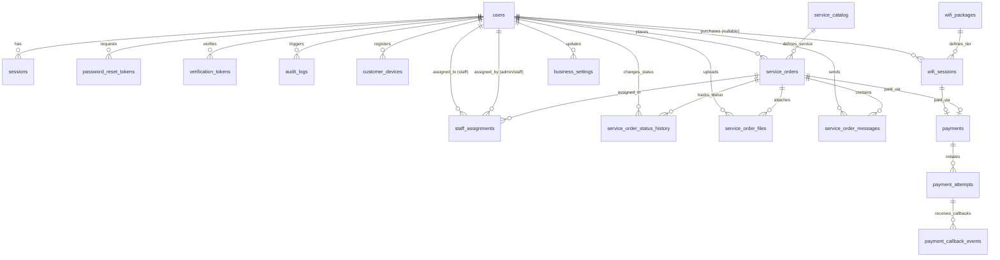

# Digital Services Hub (DSH) — Database Architecture & Schema Specification

## 1. Overview & Design Principles

The DSH database layer is built on **PostgreSQL 18** and modeled using **Drizzle ORM** inside the `@dsh/backend` workspace (`backend/src/db/schema/`).

### Core Architectural Invariants
1. **Backend-Only Authority**: The frontend (`@dsh/frontend`) never connects to PostgreSQL or imports Drizzle schema modules directly.
2. **Immutable Financial & Catalog Snapshots**:
   - `wifi_sessions` snapshots `package_name_snapshot`, `amount_snapshot`, and `duration_minutes_snapshot` at creation time.
   - `service_orders` snapshots `service_name_snapshot`, `unit_price_snapshot`, `pricing_unit_snapshot`, and `total_amount` at order creation time.
   - Subsequent admin edits to `wifi_packages` or `service_catalog` never alter historical records.
3. **Decoupled Payment vs. Network Authorization**:
   - Payment completion (`payments.status = 'SUCCESS'`) transitions a Wi-Fi session to `PENDING_AUTHORIZATION`, **never** directly to `ACTIVE`.
   - Only confirmed gateway authorization sets `wifi_sessions.status = 'ACTIVE'` and `authorized_at`.
4. **Anonymous Wi-Fi Support**:
   - `wifi_sessions.customer_id` is nullable so walk-in captive portal users can purchase and use Wi-Fi without creating a DSH account.
5. **Strict Payment Target Exclusivity (XOR Constraint)**:
   - Each logical `payments` record must reference **either** `wifi_session_id` **or** `service_order_id` — never both and never neither (`(wifi_session_id IS NOT NULL AND service_order_id IS NULL) OR (wifi_session_id IS NULL AND service_order_id IS NOT NULL)`).
6. **Non-Destructive Financial & Audit Retention**:
   - Financial records (`payments`, `payment_attempts`, `payment_callback_events`), operational records (`wifi_sessions`, `service_orders`, `service_order_status_history`), and security records (`audit_logs`) use `ON DELETE RESTRICT` or `ON DELETE SET NULL`.
   - User accounts are deactivated (`status = 'DISABLED'`) rather than hard-deleted in normal operations.
7. **Zero Secrets in Database Metadata**:
   - Passwords are stored exclusively as Argon2id hashes (`users.password_hash`).
   - Session, password-reset, and verification tokens are stored only as cryptographic hashes (`token_hash`).
   - `audit_logs.metadata`, `payment_callback_events.safe_metadata`, and `business_settings.value` must never store raw credentials, API keys, or secrets.

---

## 2. Entity-Relationship Diagram

---

## 3. PostgreSQL Enums (`enums.ts`)

| Enum Name | Values | Purpose |
| :--- | :--- | :--- |
| `user_role` | `CUSTOMER`, `STAFF`, `ADMIN`, `SUPER_ADMIN` | Role-based access control |
| `account_status` | `ACTIVE`, `DISABLED` | Account lifecycle state |
| `verification_type` | `EMAIL`, `PHONE` | Channel for `verification_tokens` |
| `wifi_session_status` | `PENDING_PAYMENT`, `PENDING_AUTHORIZATION`, `ACTIVE`, `EXPIRED`, `REVOKED`, `FAILED` | Decoupled payment & gateway lifecycle |
| `payment_status` | `PENDING`, `SUCCESS`, `FAILED`, `CANCELLED`, `REVERSED` | Logical payment & attempt status |
| `payment_provider` | `MPESA` | Payment gateway provider |
| `service_pricing_unit` | `FIXED`, `PER_PAGE`, `PER_HOUR`, `PER_SESSION`, `PER_SET` | Catalog & order pricing model |
| `service_order_status` | `DRAFT`, `PAYMENT_PENDING`, `PAID`, `QUEUED`, `IN_PROGRESS`, `WAITING_FOR_CUSTOMER`, `READY`, `COMPLETED`, `CANCELLED`, `REFUNDED` | End-to-end digital service order workflow |
| `message_visibility` | `CUSTOMER`, `INTERNAL` | Separates customer-visible chat from internal staff notes |

---

## 4. Table Specifications

### Domain A: Users, Sessions & Security

#### 1. `users` (`users.ts`)
Stores registered customer, staff, admin, and super-admin accounts.
- **Primary Key**: `id` (`uuid`, default `gen_random_uuid()`)
- **Columns**:
  - `first_name` (`varchar(100)`, NOT NULL)
  - `last_name` (`varchar(100)`, NOT NULL)
  - `email` (`varchar(255)`, nullable, unique)
  - `phone_number` (`varchar(32)`, nullable, unique)
  - `password_hash` (`text`, NOT NULL)
  - `role` (`user_role`, NOT NULL, default `'CUSTOMER'`)
  - `status` (`account_status`, NOT NULL, default `'ACTIVE'`)
  - `email_verified_at` (`timestamptz`, nullable)
  - `phone_verified_at` (`timestamptz`, nullable)
  - `last_login_at` (`timestamptz`, nullable)
  - `created_at` (`timestamptz`, NOT NULL, default `now()`)
  - `updated_at` (`timestamptz`, NOT NULL, default `now()`)
- **Constraints & Indexes**:
  - Unique constraint on `email` (`users_email_unique`)
  - Unique constraint on `phone_number` (`users_phone_number_unique`)
  - `CHECK (email IS NOT NULL OR phone_number IS NOT NULL)`: Every user must have at least one contact identifier.
  - `CHECK (email IS NULL OR (email = lower(trim(email)) AND char_length(email) >= 3))` (`users_email_normalized_chk`): Enforces lowercase trimmed storage so `users_email_unique` operates on canonical case-normalized values.
  - `CHECK (phone_number IS NULL OR (phone_number = trim(phone_number) AND phone_number ~ '^\+[1-9][0-9]{7,14}$'))` (`users_phone_normalized_chk`): Enforces canonical E.164 phone numbers (`+2547XXXXXXXX` / `+2541XXXXXXXX`).
  - Index on `(role, status)` for administrative filtering.

#### 2. `sessions` (`sessions.ts`)
Server-side authenticated user sessions. Stores only hashed tokens.
- **Primary Key**: `id` (`uuid`)
- **Foreign Keys**: `user_id` -> `users.id` (`ON DELETE CASCADE`)
- **Columns**: `token_hash` (`varchar(128)`, unique, NOT NULL), `expires_at` (`timestamptz`, NOT NULL), `revoked_at` (`timestamptz`, nullable), `ip_address` (`varchar(64)`, nullable), `user_agent` (`text`, nullable), `created_at` (`timestamptz`, NOT NULL)
- **Constraints & Indexes**:
  - Unique index on `token_hash`
  - Index on `(user_id, expires_at)`
  - `CHECK (expires_at > created_at)`

#### 3. `password_reset_tokens` (`sessions.ts`)
One-time password reset token hashes.
- **Primary Key**: `id` (`uuid`)
- **Foreign Keys**: `user_id` -> `users.id` (`ON DELETE CASCADE`)
- **Columns**: `token_hash` (`varchar(128)`, unique, NOT NULL), `expires_at` (`timestamptz`, NOT NULL), `used_at` (`timestamptz`, nullable), `created_at` (`timestamptz`, NOT NULL)
- **Indexes**: Unique on `token_hash`, index on `user_id`.

#### 4. `verification_tokens` (`sessions.ts`)
Email and phone verification token hashes.
- **Primary Key**: `id` (`uuid`)
- **Foreign Keys**: `user_id` -> `users.id` (`ON DELETE CASCADE`)
- **Columns**: `token_hash` (`varchar(128)`, unique, NOT NULL), `verification_type` (`verification_type`, NOT NULL), `attempt_count` (`integer`, NOT NULL, default `0`), `expires_at` (`timestamptz`, NOT NULL), `used_at` (`timestamptz`, nullable), `created_at` (`timestamptz`, NOT NULL)
- **Constraints & Indexes**: Unique on `token_hash`, index on `(user_id, verification_type)`, `CHECK (expires_at > created_at)`, `CHECK (attempt_count >= 0)` (`verification_tokens_attempt_count_non_negative_chk`).

#### 5. `audit_logs` (`audit.ts`)
Immutable operational and security audit trail.
- **Primary Key**: `id` (`uuid`)
- **Foreign Keys**: `actor_user_id` -> `users.id` (`ON DELETE SET NULL`, nullable for system/webhook events)
- **Columns**: `action` (`varchar(120)`, NOT NULL), `entity_type` (`varchar(80)`, NOT NULL), `entity_id` (`varchar(128)`, nullable), `metadata` (`jsonb`, NOT NULL, default `'{}'`), `ip_address` (`varchar(64)`, nullable), `created_at` (`timestamptz`, NOT NULL)
- **Immutability**:
  - **Application Layer**: Repository/service modules only expose `INSERT` and `SELECT` methods.
  - **Database Layer (Migration Trigger)**: A `BEFORE UPDATE OR DELETE` trigger (`prevent_append_only_mutation()`) blocks any row modification or deletion.
- **Indexes**: Index on `actor_user_id`, index on `(entity_type, entity_id)`, index on `created_at`.

---

### Domain B: Wi-Fi Packages, Sessions & Devices (`wifi.ts`)

#### 6. `wifi_packages`
Admin-configurable Wi-Fi hotspot tiers.
- **Primary Key**: `id` (`uuid`)
- **Columns**: `name` (`varchar(100)`, NOT NULL), `slug` (`varchar(100)`, unique, NOT NULL), `description` (`text`, nullable), `price` (`numeric(10, 2)`, NOT NULL), `currency` (`varchar(3)`, NOT NULL, default `'KES'`), `duration_minutes` (`integer`, NOT NULL), `is_active` (`boolean`, NOT NULL, default `true`), `display_order` (`integer`, NOT NULL, default `0`), `created_at`, `updated_at`.
- **Constraints**:
  - `CHECK (price > 0)`
  - `CHECK (duration_minutes > 0)`
  - `CHECK (char_length(currency) = 3)`

#### 7. `wifi_sessions`
Tracks both anonymous and customer-linked Wi-Fi sessions with full price/duration snapshots.
- **Primary Key**: `id` (`uuid`)
- **Foreign Keys**:
  - `customer_id` -> `users.id` (`ON DELETE SET NULL`, nullable)
  - `package_id` -> `wifi_packages.id` (`ON DELETE RESTRICT`, NOT NULL)
- **Columns**:
  - `package_name_snapshot` (`varchar(100)`, NOT NULL)
  - `amount_snapshot` (`numeric(10, 2)`, NOT NULL)
  - `currency` (`varchar(3)`, NOT NULL, default `'KES'`)
  - `duration_minutes_snapshot` (`integer`, NOT NULL)
  - `phone_number` (`varchar(32)`, NOT NULL)
  - `client_mac` (`varchar(32)`, nullable)
  - `client_ip` (`varchar(64)`, nullable)
  - `status` (`wifi_session_status`, NOT NULL, default `'PENDING_PAYMENT'`)
  - `started_at` (`timestamptz`, nullable)
  - `expires_at` (`timestamptz`, nullable)
  - `authorized_at` (`timestamptz`, nullable)
  - `gateway_reference` (`varchar(128)`, nullable)
  - `created_at`, `updated_at`
- **Constraints & Indexes**:
  - `CHECK (amount_snapshot > 0)`
  - `CHECK (duration_minutes_snapshot > 0)`
  - `CHECK (expires_at IS NULL OR started_at IS NULL OR expires_at > started_at)`
  - `CHECK (phone_number = trim(phone_number) AND phone_number ~ '^\+[1-9][0-9]{7,14}$')` (`wifi_sessions_phone_normalized_chk`)
  - `CHECK (client_mac IS NULL OR (client_mac = upper(trim(client_mac)) AND client_mac ~ '^([0-9A-F]{2}:){5}[0-9A-F]{2}$'))` (`wifi_sessions_mac_normalized_chk`)
  - Indexes on `customer_id`, `package_id`, `(status, expires_at)`, `phone_number`, `client_mac`.

#### 8. `customer_devices`
Registered customer MAC addresses for repeat portal convenience.
- **Primary Key**: `id` (`uuid`)
- **Foreign Keys**: `customer_id` -> `users.id` (`ON DELETE CASCADE`, NOT NULL)
- **Columns**: `device_name` (`varchar(100)`, NOT NULL), `mac_address` (`varchar(32)`, NOT NULL), `is_active` (`boolean`, NOT NULL, default `true`), `last_seen_at` (`timestamptz`, nullable), `created_at` (`timestamptz`, NOT NULL).
- **Constraints & Indexes**:
  - Unique composite constraint on `(customer_id, mac_address)` (`customer_devices_customer_mac_unique`)
  - `CHECK (mac_address = upper(trim(mac_address)) AND mac_address ~ '^([0-9A-F]{2}:){5}[0-9A-F]{2}$')` (`customer_devices_mac_normalized_chk`)
  - Index on `mac_address`.

---

### Domain C: Payments, Attempts & Idempotent Callbacks (`payments.ts`)

#### 9. `payments`
Represents one logical payment for a single purchase target (`wifi_session_id` XOR `service_order_id`).
- **Primary Key**: `id` (`uuid`)
- **Foreign Keys**:
  - `wifi_session_id` -> `wifi_sessions.id` (`ON DELETE RESTRICT`, nullable, unique)
  - `service_order_id` -> `service_orders.id` (`ON DELETE RESTRICT`, nullable, unique)
- **Columns**:
  - `reference` (`varchar(64)`, unique, NOT NULL)
  - `provider` (`payment_provider`, NOT NULL, default `'MPESA'`)
  - `amount` (`numeric(10, 2)`, NOT NULL)
  - `currency` (`varchar(3)`, NOT NULL, default `'KES'`)
  - `status` (`payment_status`, NOT NULL, default `'PENDING'`)
  - `paid_at` (`timestamptz`, nullable)
  - `reversed_at` (`timestamptz`, nullable)
  - `created_at`, `updated_at`
- **Critical Constraints**:
  - **XOR Target Check**: `CHECK ((wifi_session_id IS NOT NULL AND service_order_id IS NULL) OR (wifi_session_id IS NULL AND service_order_id IS NOT NULL))`
  - **Positive Amount**: `CHECK (amount > 0)`
  - **One Logical Payment per Purchase**: Unique constraint on `wifi_session_id` and Unique constraint on `service_order_id`.

#### 10. `payment_attempts`
Tracks individual STK push or payment initiation attempts against a logical `payments` record.
- **Primary Key**: `id` (`uuid`)
- **Foreign Keys**: `payment_id` -> `payments.id` (`ON DELETE RESTRICT`, NOT NULL)
- **Columns**:
  - `attempt_number` (`integer`, NOT NULL)
  - `merchant_request_id` (`varchar(128)`, nullable, unique)
  - `checkout_request_id` (`varchar(128)`, nullable, unique)
  - `mpesa_receipt_number` (`varchar(64)`, nullable, unique)
  - `result_code` (`varchar(32)`, nullable)
  - `result_description` (`text`, nullable)
  - `status` (`payment_status`, NOT NULL, default `'PENDING'`)
  - `initiated_at` (`timestamptz`, NOT NULL, default `now()`)
  - `completed_at` (`timestamptz`, nullable)
  - `created_at` (`timestamptz`, NOT NULL, default `now()`)
- **Constraints & Indexes**:
  - `CHECK (attempt_number >= 1)`
  - Unique composite constraint on `(payment_id, attempt_number)`
  - Unique constraints on `merchant_request_id`, `checkout_request_id`, and `mpesa_receipt_number`.

#### 11. `payment_callback_events`
Ensures idempotent webhook/callback processing from Safaricom Daraja.
- **Primary Key**: `id` (`uuid`)
- **Foreign Keys**: `payment_attempt_id` -> `payment_attempts.id` (`ON DELETE RESTRICT`, NOT NULL)
- **Columns**:
  - `idempotency_key` (`varchar(160)`, unique, NOT NULL)
  - `provider_event_id` (`varchar(128)`, nullable, unique)
  - `outcome` (`varchar(64)`, NOT NULL)
  - `received_at` (`timestamptz`, NOT NULL, default `now()`)
  - `processed_at` (`timestamptz`, nullable)
  - `safe_metadata` (`jsonb`, NOT NULL, default `'{}'`)
- **Constraints & Indexes**:
  - Unique constraint on `idempotency_key`
  - Unique constraint on `provider_event_id`
  - Index on `payment_attempt_id`

---

### Domain D: Digital Services, Orders, Staff & Files

#### 12. `service_catalog` (`services.ts`)
Admin-managed digital services catalog.
- **Primary Key**: `id` (`uuid`)
- **Columns**: `name` (`varchar(150)`, NOT NULL), `slug` (`varchar(150)`, unique, NOT NULL), `description` (`text`, nullable), `price` (`numeric(10, 2)`, NOT NULL), `currency` (`varchar(3)`, NOT NULL, default `'KES'`), `pricing_unit` (`service_pricing_unit`, NOT NULL), `is_active` (`boolean`, NOT NULL, default `true`), `display_order` (`integer`, NOT NULL, default `0`), `created_at`, `updated_at`.
- **Constraints**: `CHECK (price > 0)`, unique `slug`.

#### 13. `service_orders` (`orders.ts`)
Customer service orders with historical pricing snapshots.
- **Primary Key**: `id` (`uuid`)
- **Foreign Keys**:
  - `customer_id` -> `users.id` (`ON DELETE RESTRICT`, NOT NULL)
  - `service_id` -> `service_catalog.id` (`ON DELETE RESTRICT`, NOT NULL)
- **Columns**:
  - `order_number` (`varchar(40)`, unique, NOT NULL)
  - `service_name_snapshot` (`varchar(150)`, NOT NULL)
  - `quantity` (`integer`, NOT NULL, default `1`)
  - `unit_price_snapshot` (`numeric(10, 2)`, NOT NULL)
  - `total_amount` (`numeric(10, 2)`, NOT NULL)
  - `currency` (`varchar(3)`, NOT NULL, default `'KES'`)
  - `pricing_unit_snapshot` (`service_pricing_unit`, NOT NULL)
  - `status` (`service_order_status`, NOT NULL, default `'DRAFT'`)
  - `customer_requirements` (`text`, nullable)
  - `form_data` (`jsonb`, NOT NULL, default `'{}'`)
  - `created_at`, `updated_at`, `completed_at` (`timestamptz`, nullable)
- **Constraints**:
  - `CHECK (quantity >= 1)` (`service_orders_quantity_positive_chk`)
  - `CHECK (unit_price_snapshot > 0)` (`service_orders_unit_price_positive_chk`)
  - `CHECK (total_amount = unit_price_snapshot * quantity)` (`service_orders_total_amount_chk`): Enforces exact multiplication because the current schema has no discount, tax, or surcharge columns.
  - Unique `order_number`.

#### 14. `staff_assignments` (`orders.ts`)
Tracks staff ownership of service orders.
- **Primary Key**: `id` (`uuid`)
- **Foreign Keys**:
  - `order_id` -> `service_orders.id` (`ON DELETE CASCADE`, NOT NULL)
  - `staff_user_id` -> `users.id` (`ON DELETE RESTRICT`, NOT NULL)
  - `assigned_by` -> `users.id` (`ON DELETE RESTRICT`, NOT NULL)
- **Columns**: `assigned_at` (`timestamptz`, NOT NULL, default `now()`), `unassigned_at` (`timestamptz`, nullable), `notes` (`text`, nullable).

#### 15. `service_order_status_history` (`orders.ts`)
Append-only audit trail of order status transitions.
- **Primary Key**: `id` (`uuid`)
- **Foreign Keys**:
  - `order_id` -> `service_orders.id` (`ON DELETE RESTRICT`, NOT NULL)
  - `changed_by` -> `users.id` (`ON DELETE SET NULL`, nullable for system/payment webhook transitions)
- **Columns**: `previous_status` (`service_order_status`, nullable), `new_status` (`service_order_status`, NOT NULL), `note` (`text`, nullable), `created_at` (`timestamptz`, NOT NULL, default `now()`).

#### 16. `service_order_files` (`files.ts`)
Private file attachments (customer uploads and staff deliverables).
- **Primary Key**: `id` (`uuid`)
- **Foreign Keys**:
  - `order_id` -> `service_orders.id` (`ON DELETE RESTRICT`, NOT NULL)
  - `uploaded_by` -> `users.id` (`ON DELETE RESTRICT`, NOT NULL)
- **Columns**: `original_filename` (`varchar(255)`, NOT NULL), `storage_key` (`varchar(512)`, unique, NOT NULL), `mime_type` (`varchar(128)`, NOT NULL), `file_size` (`integer`, NOT NULL), `checksum` (`varchar(128)`, NOT NULL), `is_deliverable` (`boolean`, NOT NULL, default `false`), `created_at` (`timestamptz`, NOT NULL, default `now()`).
- **Constraints**: `CHECK (file_size > 0)`, unique `storage_key`.

#### 17. `service_order_messages` (`messages.ts`)
Order-scoped messages with strict `CUSTOMER` vs `INTERNAL` visibility separation.
- **Primary Key**: `id` (`uuid`)
- **Foreign Keys**:
  - `order_id` -> `service_orders.id` (`ON DELETE CASCADE`, NOT NULL)
  - `sender_user_id` -> `users.id` (`ON DELETE RESTRICT`, NOT NULL)
- **Columns**: `body` (`text`, NOT NULL), `visibility` (`message_visibility`, NOT NULL, default `'CUSTOMER'`), `created_at`, `updated_at`.

---

### Domain E: Business Settings (`settings.ts`)

#### 18. `business_settings`
Non-secret operational configuration managed by administrators.
- **Primary Key**: `id` (`uuid`)
- **Foreign Keys**: `updated_by` -> `users.id` (`ON DELETE SET NULL`, nullable)
- **Columns**: `key` (`varchar(120)`, unique, NOT NULL), `value` (`jsonb`, NOT NULL), `description` (`text`, nullable), `created_at`, `updated_at`.

---

## 5. Contact & Device Identifier Normalization (`backend/src/db/normalize.ts`)

To ensure unique indexes and lookups never fail due to casing or formatting differences, all contact and device identifiers are normalized in the backend (`backend/src/db/normalize.ts`) before persistence and enforced at the PostgreSQL level via `CHECK` constraints:

1. **Email (`users.email`)**:
   - **Rule**: `normalizeEmail()` trims whitespace and converts to lowercase.
   - **Database Constraint**: `users_email_normalized_chk` (`email IS NULL OR (email = lower(trim(email)) AND char_length(email) >= 3)`).
2. **Phone Number (`users.phone_number`, `wifi_sessions.phone_number`)**:
   - **Rule**: `normalizePhoneNumber()` strips spaces/hyphens and converts Kenyan local formats (`07XXXXXXXX`, `01XXXXXXXX`, `2547XXXXXXXX`) into canonical E.164 format (`+2547XXXXXXXX`).
   - **Database Constraints**: `users_phone_normalized_chk` and `wifi_sessions_phone_normalized_chk` (`^\+[1-9][0-9]{7,14}$`).
3. **MAC Address (`customer_devices.mac_address`, `wifi_sessions.client_mac`)**:
   - **Rule**: `normalizeMacAddress()` strips colons/hyphens, uppercases hex digits, and formats as colon-separated pairs (`AA:BB:CC:DD:EE:FF`).
   - **Database Constraints**: `customer_devices_mac_normalized_chk` and `wifi_sessions_mac_normalized_chk` (`^([0-9A-F]{2}:){5}[0-9A-F]{2}$`).

---

## 6. Append-Only Immutability for Audit & History Tables

Both `audit_logs` and `service_order_status_history` are strictly append-only:

1. **Application Layer**:
   - Backend repositories and services only expose `insert` and `select` functions for `audit_logs` and `service_order_status_history`. No `update` or `delete` functions exist.
2. **Database Migration Layer (`backend/drizzle/0000_bored_electro.sql`)**:
   - Trigger Function: `"public"."prevent_append_only_mutation"()` raises `EXCEPTION 'Table "%" is append-only; % operations are prohibited.'` (`ERRCODE = 'integrity_constraint_violation'`).
   - Triggers Installed:
     - `audit_logs_prevent_mutation_trg` (`BEFORE UPDATE OR DELETE ON "public"."audit_logs" FOR EACH ROW`)
     - `service_order_status_history_prevent_mutation_trg` (`BEFORE UPDATE OR DELETE ON "public"."service_order_status_history" FOR EACH ROW`)
   - Actor references (`actor_user_id`, `changed_by`) use `ON DELETE SET NULL` so user lifecycle actions never cascade-delete audit or status history rows.

---

## 7. Migrations & Schema Governance

- **Schema Entry Point**: `backend/src/db/schema/index.ts`
- **Migration Output Directory**: `backend/drizzle/`
  - Initial Migration: `backend/drizzle/0000_bored_electro.sql`
  - Metadata & Snapshot: `backend/drizzle/meta/0000_snapshot.json`, `backend/drizzle/meta/_journal.json`
- **Database Journal Table**: `drizzle.__drizzle_migrations` tracks applied migration hashes and timestamps so repeated executions of `npm run db:migrate` are idempotent no-ops.
- **Safety Rules**:
  - Always generate committed SQL migrations (`npm run db:generate`) and apply them via `npm run db:migrate`.
  - Never use `drizzle-kit push` or destructive volume resets (`docker compose down -v`).
